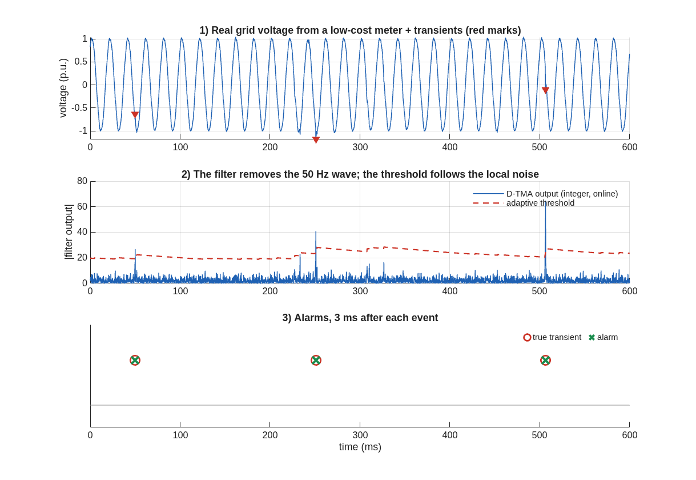
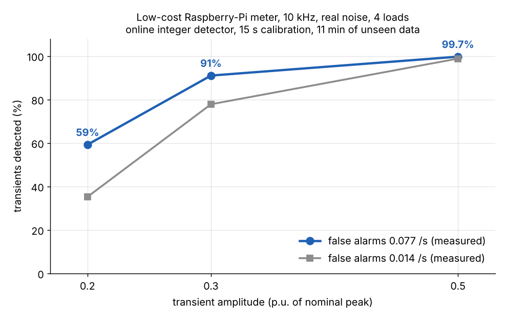
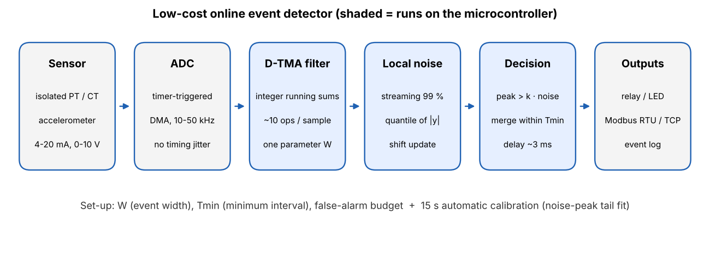

# Low-cost online event detector for industrial signals

**One small integer algorithm, one physical parameter, 15 seconds of calibration, and it runs online on a microcontroller.**

This repository shows the detector working on **real voltage recordings from a low-cost Raspberry-Pi energy meter**: the cheapest setup you will find in practice. Power-quality transients are the first application. The same core is meant for vibration impulses, pulse counting and pressure spikes (see [Applications](#applications)).

Author: **Mohsen Karimi**, independent researcher, Zanjan, Iran · ORCID [0009-0004-1055-8267](https://orcid.org/0009-0004-1055-8267) · mohsensbu@gmail.com

---

## Specifications (measured on a low-cost meter)

**Test conditions:** a Raspberry-Pi meter at 10 kHz, four loads (resistive, induction motor, ceiling fan, SMPS charger) and the meter's own real noise. Each run used a 15 s calibration followed by **11 minutes of unseen data** (4 loads × 4 different calibration windows), with about 2 transients per second.

| Transient amplitude | Detected, false-alarm setting 0.1 /s | Detected, setting 0.03 /s |
|---|---|---|
| 0.5 p.u. | **99.7 %** | 98.8 % |
| 0.3 p.u. | **91.0 %** | 77.8 % |
| 0.2 p.u. | 59.2 % | 35.2 % |
| False alarms measured on unseen data | 0.077 /s | 0.014 /s |

| | |
|---|---|
| Decision delay (event → alarm) | **≈ 3 ms** |
| Cost per sample | ≈ 20 integer operations (filter: 9 add/sub + 1 multiply) |
| Memory | 30 integers of buffers + 8 state variables |
| Number format | integers only; fits in 32 bit |
| Set-up | event width **W**, minimum interval **Tmin**, false-alarm setting |
| Calibration | 15 s of normal operation, automatic |
| Rated detection on this meter | transients **≥ 0.3 p.u.** |

The detection floor is set by the meter's front end: its noise is 0.015–0.027 p.u. RMS. A better front end lowers it in proportion (see [Hardware set-up](#hardware-set-up)).

Sources: [`07_adaptive_threshold_output.txt`](07_adaptive_threshold_output.txt) (method `static/q99`) and [`05_online_integer_output.txt`](05_online_integer_output.txt).

---

## How it works

1. **D-TMA band-pass filter.** This is the author's filter, first implemented in 2008. Two triangular moving averages, each made of two running sums:

   `y = TMA( x − TMA(x, w1), w2 )`, with `w1 = 3.3·W` and `w2 = 0.06·W`

   - It rejects DC exactly: the 50 Hz wave and slow drifts are removed.
   - It needs only integer additions and one multiply per sample.
   - **W**, the physical width of the event, is the only design parameter.
2. **Local noise level.** The threshold follows the local noise instead of one fixed level. The device tracks the 99 % quantile of |y| with a streaming integer update (one compare, one shift, one add per sample), so the threshold follows the *tail* of the noise. This is what keeps false alarms under control when the noise changes.
3. **Decision.** A local peak above `k × noise` is an event. Peaks closer than **Tmin** are merged, and the alarm is issued ~2 ms after the peak.
4. **Automatic calibration.** For 15 s of normal operation, the device logs the score of every noise peak (about 90 per second, so over a thousand in 15 s). It fits the upper tail of their distribution with a power law and computes `k` for the requested false-alarm rate. No training data and no learning. Counting the rare false alarms directly was tried first: 15 s holds only one or two of them, so that estimate was unreliable. The tail fit uses all the peaks.

---

## How it was tested

The public data has no labelled real transients. So the test injects transients of known size and time (double-exponential, 100/400 µs, random sign) into the **real voltage**, and the **real noise of the meter** is the only noise.

| Step | Script | What it showed |
|---|---|---|
| 1 | [`PQ_timing_check.m`](PQ_timing_check.m) | The meter's sample clock jitters, and the recording has gaps up to 17 ms. Resampling onto the real timestamps cut the apparent noise from 0.087 to 0.037 p.u. **Check the data before blaming the detector.** |
| 2 | [`PQ_four_loads.m`](PQ_four_loads.m) | Four loads, recorder gaps masked. The meter noise is heavy-tailed, so the threshold must be calibrated. |
| 3 | [`PQ_lowcost_equal_FA.m`](PQ_lowcost_equal_FA.m) | Detection rate at equal false-alarm settings; on par with a db4 wavelet detector, a common choice in power-quality monitoring |
| 4 | [`PQ_online_integer.m`](PQ_online_integer.m) | Causal, sample-by-sample, integer version. Same result as the offline version; ≈ 3 ms delay; no 32-bit overflow. |
| 5 | [`PQ_calibration_fix.m`](PQ_calibration_fix.m) | Counting rare alarms in 15 s is unreliable; the power-law tail fit is reliable |
| 6 | [`PQ_adaptive_threshold.m`](PQ_adaptive_threshold.m) | The quantile noise tracker holds the false-alarm rate on all 16 calibration/test pairs and gives the best detection rate |
| — | [`PQ_detector_final.m`](PQ_detector_final.m) | **The final detector** in one file, with a demo and the figures of this page |

---

## Hardware set-up

**Data used here:** [BidyutPi](https://data.mendeley.com/datasets/5jp4r7nnpw/2) open-source smart meter (Raspberry Pi, 10 kHz, 60 s per load). It is a deliberately low-end set-up.

**Lessons for a real device:** the problems found in this data (clock jitter, recording gaps, heavy-tailed noise) are cheap to avoid. Details are in [`hardware_setup.md`](hardware_setup.md).

| Block | Recommended |
|---|---|
| Sampling | Microcontroller ADC started by a **hardware timer**, data moved by **DMA**. No operating-system timing. |
| Input | Isolated voltage/current sensing (PT/CT, isolated amplifier); IEPE for accelerometers; 4–20 mA / 0–10 V for process sensors |
| Rate | 10–50 kHz for power quality and vibration; 1 kHz is enough for pressure |
| Outputs | Relay or transistor alarm, status LED, Modbus RTU (RS-485) or Modbus TCP, event log with time stamps |
| Form | DIN-rail module, 24 V DC supply, like a standard industrial I/O card |

---

## Applications

The core stays the same; only two physical numbers change. The values below are starting points to be checked on each application's data.

| Application | Sensor | Sampling | W (event width) | Tmin |
|---|---|---|---|---|
| Power-quality transients | isolated voltage divider / PT | 10–50 kHz | 0.2–0.5 ms | 2 ms |
| Bearing fault impulses | accelerometer | 12–50 kHz | 0.1–0.5 ms | fraction of fault period |
| Load switching, motor start | CT | 10 kHz | 1–5 ms | a few cycles |
| Pulse counting (encoder, tachometer) | inductive / optical | 1–10 kHz | pulse width | minimum period |
| Pressure spikes (pumps, hydraulics) | pressure transmitter | ~1 kHz | 10–50 ms | process dependent |

Partial discharge and acoustic emission use the same algorithm but need MHz sampling hardware.

---

## Run it yourself

MATLAB (also MATLAB Online), no toolboxes. All output is text.

1. `PQ_four_loads.m`: downloads the four recordings (~120 MB, once) and runs the four-load test
2. `PQ_detector_final.m`: the final detector, its key numbers and the three PNG figures
3. The other scripts reproduce each development step (table above)

The outputs of the author's runs are in the `*_output.txt` files (index: [`results_index.md`](results_index.md)).

---

## Credits

- **Method and ideas: Mohsen Karimi.** This covers the D-TMA filter, the local noise rule, the evaluation by SNR band, the physical parameterisation by W, and online use after a short calibration. The filter was first developed for ECG/QRS detection: [Asymmetric-TMA-Bandpass](https://github.com/mohsensbu-jpg/Asymmetric-TMA-Bandpass).
- Coding and analysis were done with the help of an AI assistant (Claude, Anthropic). Design decisions and interpretation are the author's.
- Data: *High-Frequency Waveforms and Continuous Power Log Data for Linear and Non-Linear Electrical Loads*, Mendeley Data, V2, doi:[10.17632/5jp4r7nnpw.2](https://doi.org/10.17632/5jp4r7nnpw.2). See the dataset page for its licence.

**Licence:** all rights reserved. For use in a product or a pilot installation, contact the author.
